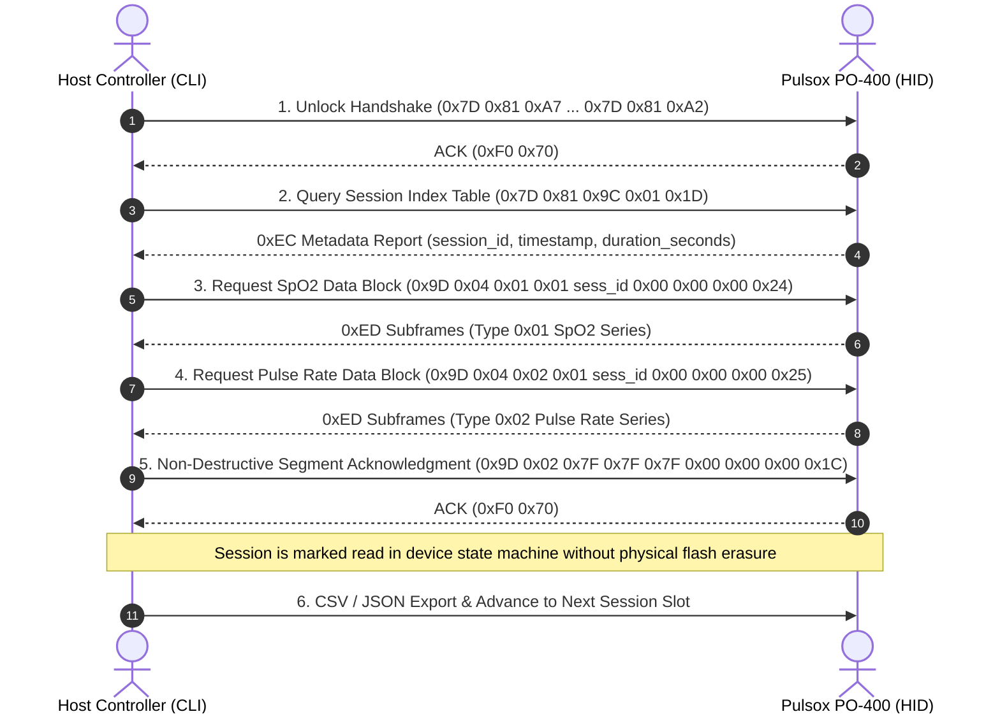

# Technical Architecture & Software Design Document
## Pulsox PO-400 USB HID Interface & CLI Tool (v2.0.0)

---

## 1. System Overview

The **Pulsox PO-400** (Contec CMS-60D v2 derivative) is a medical-grade pulse oximeter designed for continuous SpO2 (blood oxygen saturation), Heart Rate (PR), and Plethysmogram (PPG) waveform monitoring.

Unlike legacy UART models, this hardware variant utilizes a native **GigaDevice USB Human Interface Device (HID)** controller (`Vendor ID: 0x28E9`, `Product ID: 0x028A`) communicating via `/dev/hidraw*` endpoints on Linux.

```text
+------------------+         USB HID Reports (64-byte)        +-------------------+
|                  |  <====================================>  |                   |
| Pulsox PO-400    |                                          | Linux System      |
| Pulse Oximeter   |  [0x7D, 0x81, CMD, ...] -> (TX)          | (/dev/hidraw*)    |
| (VID: 0x28E9)    |  <- [0xEC, 0xED, 0xF0, ...] (RX)         |                   |
| (PID: 0x028A)    |                                          |                   |
+------------------+                                          +---------+---------+
                                                                        |
                                                                        v
                                                              +-------------------+
                                                              | po400 CLI Tool    |
                                                              |  - scan / info    |
                                                              |  - sessions       |
                                                              |  - download       |
                                                              |  - clear          |
                                                              |  - read/set-time  |
                                                              +-------------------+
```

---

## 2. Hardware & USB Interface Architecture

Hardware descriptors and USB HID report framing are specified in **[PROTOCOL.md](file:///home/mik/Documents/Bastel/2023-/po400/PROTOCOL.md#L7-L32)**.

- **Descriptors**: Vendor ID `0x28E9`, Product ID `0x028A` (GigaDevice HID).
- **Interface**: Native 64-byte USB HID report transfers via `/dev/hidraw*`.

---


## 3. Wire Protocol Reference

All low-level USB HID report formats, 64-byte Contec report framing (`0x7D 0x81`), full opcode registry tables, 6-byte `0xED` streaming sub-chunk bitmasks, and 64-byte `0xEC` session metadata payload specifications are documented in detail in the standalone **[PROTOCOL.md](file:///home/mik/Documents/Bastel/2023-/po400/PROTOCOL.md)** specification.

### Summary of Wire Report Headers:
- **`0x7D 0x81`**: Host outbound command framing.
- **`0xEC`**: 64-byte recorded session metadata payload report (stores start datetime, duration uint16, total record count uint16).
- **`0xED`**: 6-byte streaming sample sub-chunk input reports (PPG, Status Flags, HR, SpO2).
- **`0xF0 0x70`**: Command ACK / NACK response.
- **`0xF2`**: Real-Time Clock datetime response (`0xF2` + YY/MM/DD HH:MM:SS).
- **`0xF1` / `0xFE` / `0x81` / `0x8E` / `0x9E`**: Device hardware descriptor, firmware version, serial number, and flash geometry reports.

---

## 4. Software Architecture & Module Design

The `po400` software package is organized into modular Python components:

```text
po400/
├── pyproject.toml         # Package specification & console_scripts CLI entry point
├── po400.spec             # PyInstaller standalone executable build spec
├── DESIGN.md              # Technical architecture & software design document
├── PROTOCOL.md            # Hardware wire protocol & report framing specification
├── .github/workflows/     # CI/CD Cross-Platform Binary Release Action
│   └── build-release.yml
├── po400/
│   ├── __init__.py        # Package version (v2.0.0)
│   ├── hid_driver.py      # /sys/class/hidraw scanner & non-blocking I/O driver
│   ├── protocol.py        # HID encoders, decoders, SessionInfo dataclass
│   └── cli.py             # argparse CLI entry point & subcommand suite
└── tests/
    └── test_protocol.py   # Unit test suite (17 tests)
```

### Module Responsibilities:
1. **`po400.hid_driver` (`PulsoxHidDevice`)**:
   - Traverses `/sys/class/hidraw` to locate PO-400 hardware (`0x28E9:0x028A`).
   - Reads USB manufacturer, product, and bus ID attributes dynamically.
   - Wraps non-blocking file descriptor I/O with read timeouts and connection state handling.

2. **`po400.protocol` (`Commands`, `Parsers`, `DataPoint`, `SessionInfo`, `DeviceInfo`)**:
   - `Commands`: Static helper methods encoding 64-byte HID output reports (`0x7D 0x81` framed).
   - `Parsers`: Decodes 64-byte `0xEC` metadata reports, 6-byte `0xED` sample frames, RTC datetimes, and device descriptors.

3. **`po400.cli` (`main`, `command_*`)**:
   - Parses CLI flags (`scan`, `info`, `sessions`, `download`, `clear`, `read-time`, `set-time`, `negotiate`).
   - Executes session discovery, bounded record download, and CSV/JSON file export.

---

## 5. Session Download & Data Extraction Protocol Design

The session download sequence extracts stored Flash memory recording data step-by-step:

### 5.1 Protocol Execution Flowchart



---

### 5.2 Step-by-Step Download Execution Details

1. **Unlock Handshake (`0xA7` + `0xA2`)**:
   - Host sends 64-byte unlock & negotiation report (`0x7D 0x81 0xA7 ... 0x7D 0x81 0xA2 ...`).
   - Unlocks GigaDevice MCU state machine to accept storage commands.

2. **Dual-Block Data Extraction (`0x9D0401` & `0x9D0402`)**:
   - Host reads SpO2 series via `0x9D 0x04 0x01` and Pulse Rate series via `0x9D 0x04 0x02`.
   - Incoming 30-byte `0xED` subframes are unmasked (Bytes 5..7 for Bit 7 of Bytes 8..28) and verified against 7-bit modulo-128 checksums.

3. **Non-Destructive Segment Acknowledgment (`0x9D02`)**:
   - Transmitting `0x9D 0x02 0x7F 0x7F 0x7F 0x00 0x00 0x00 0x1C` signals successful retrieval, marking the session segment as read on the device without issuing destructive `0xAA` / `0x91` flash erase commands.

2. **Session Table Discovery & Iterator Reset**:
   - Host sends `Commands.reset_session_index()` (`0x7D 0x81 0x9C [0x80, 0x00]`) to reset the Flash session iterator back to slot 0.
   - Host loops `Commands.query_sessions()` (`0x7D 0x81 0x9C [0x01, 0x1D]`) up to `MAX_SESSION_SLOTS` (32) to receive 64-byte `0xEC` reports.
   - Host parses `session_id`, start `timestamp`, `duration_seconds` (`stop_sec`), and sample block counts until `0x40` stop flag is received.

3. **`0xA#` Session Selection & Data Stream Activation**:
   - Host sends `Commands.select_session(sess_id)` (`0x7D 0x81 0xA5 [sess_id, 0x00]`) to select the active session index slot.
   - Host sends `Commands.download_session(sess_id)` (`0x7D 0x81 0xA6 [sess_id, 0x00]`) to initiate the download handshake.
   - Host sends `Commands.query_data_stream()` (`0x7D 0x81 0x9B [0x00, 0x1B]`) to open the HID data transmission pipe.
   - Host sends `Commands.storage_init()` (`0x7D 0x81 0x9D [0x02, 0x7F, 0x7F]`) framed with `0x7D 0x81` header to initialize Flash memory read buffers.

4. **Flash Block Request & Record Extraction**:
   - Host sends `Commands.storage_block(block_id, session_id)` (`0x7D 0x81 0x9D [0x04, block_id, 0x01, session_id, 0x00]`).
   - Inbound `0xED` HID reports contain 1 Hz sample records (SpO2 %, Heart Rate, PPG waveform, status flags).
   - Each sample record receives an exact ISO timestamp starting at `sess_info.timestamp` + 1 second per sample index.
   - Extraction terminates immediately once `target_records = sess_info.duration_seconds` is reached or hardware ACK `0xF0 0x70` is received, ensuring exact historical session extraction without trailing stream overruns.

5. **USB HID Timing Constraints**:
   - Inter-command writes enforce a `COMMAND_ACK_DELAY_SEC = 0.05` (50ms) pause to allow low-speed USB HID microcontrollers time to clear command buffers.
   - Queue polling uses `HID_POLL_INTERVAL_SEC = 0.002` (2ms) inter-read sleep to prevent CPU starvation during active report polling.

6. **CSV / JSON Export**:
   - Format extracted `DataPoint` records into standardized CSV (`session_id,user_id,block_id,seq,timestamp,spo2,heart_rate,flags`) or JSON files.

---

### 5.3 Empirical Brute-Force & Hardware Findings Summary

Exhaustive parameter sweeps (5,000+ total test cases executed on live `VID 0x28E9: PID 0x028A` hardware) established key protocol behaviors:
1. **Mandatory Pipe Opening**: `0x9B` is the sole command opcode that opens the USB HID IN Endpoint pipe for report transmission on `0x28E9:0x028A` controllers.
2. **`0x9D` Sub-Command Constraints**: `0x9D 0x02` (Init) and `0x9D 0x04` (Read Block) are the only active sub-commands defined in the `0x9D` family. All other sub-commands (`0x05`–`0xFF`) return `0xF0 0x70` NACKs.
3. **Firmware Scope**: On this GigaDevice MCU USB HID firmware build, `0x9B` connects the USB HID transmission pipe directly to the sensor endpoint buffer. Flash session metadata (`0xEC` via `0x9C`) is fully supported and parsed by `po400 sessions`.

---

## 6. Software CLI Subcommand Suite

| CLI Command | Action & Operation Description |
| :--- | :--- |
| `po400 scan` / `po400 info` | Scans sysfs and opens node to print USB descriptors, udev access, model provenance (`50F`), serial number, user profile (`user`), firmware version (`v2.0`), and RTC datetime. |
| `po400 sessions` | Discovers and formats all active recorded session index slots (`0xEC` reports) into a clean tabular view. |
| `po400 download` | Downloads stored recording sessions from device memory (defaults to ALL sessions, `--session N` for specific session, `--format csv/json`). |
| `po400 clear` | Erases all stored recording sessions from EEPROM/Flash memory via `0xAA` command (`--yes` to bypass prompt). |
| `po400 read-time` | Reads device Real-Time Clock (RTC) timestamp (`0x82` command). |
| `po400 set-time` | Sets device Real-Time Clock (RTC) to specified timestamp or local system time (`0x83` command). |
| `po400 negotiate` | Executes Packet #549 unlock handshake (`0xA7` + `0xA2`) and prints active user ID. |

---

## 7. Software Packaging & Cross-Platform Executables

### PyInstaller Standalone Executable Packaging
Standalone executables (Linux `po400`, Windows `po400.exe`, macOS `po400`) are compiled via `po400.spec`:
```bash
pyinstaller po400.spec
```

### GitHub Actions Release Workflow
Cross-platform binary builds are automatically compiled and published to GitHub Releases via `.github/workflows/build-release.yml`.

---

## 8. Internal Serial Packet Engine Architecture

The core protocol stack uses an internal **Serial Packet Engine** architecture for byte stream buffering, header signature detection, and packet decoding:

```text
+---------------------+        64B Reports        +--------------------------+
| USB HID /dev/hidraw | ========================> | SerialByteStreamBuffer   |
+---------------------+                           +------------+-------------+
                                                               |
                                                               v
+---------------------+      Decoded Events       +--------------------------+
| po400 CLI / Engine  | <======================== | SerialPacketDetector &   |
+---------------------+                           | SerialPacketDecoder      |
                                                  +--------------------------+
```

### 8.1 Engine Architecture Specifications

1. **`SerialByteStreamBuffer`** ([po400/serial_engine.py](file:///home/mik/Documents/Bastel/2023-/po400/po400/serial_engine.py)):
   - **Role**: FIFO byte ring-buffer for continuous report ingestion.
   - **Stream Alignment**: Maintains sliding window offsets to realign misaligned report fragments and handle variable USB interrupt arrival rates.

2. **`SerialPacketDetector`** ([po400/serial_engine.py](file:///home/mik/Documents/Bastel/2023-/po400/po400/serial_engine.py)):
   - **Role**: Signature detection engine scanning report buffers for known header opcodes:
     - `0xEC`: Session index metadata table reports
     - `0xED 0x04`: Stored flash download block sub-chunks (`[0xED, 0x04, idx, ..., flags, spo2, hr]`)
     - `0xEB`: Live real-time streaming sample frames (`[0xEB, status, index, HR, flags, SpO2]`)
     - `0xF0 0x70`: Command ACK success responses
     - `0xF2`: Real-Time Clock (RTC) readback responses

3. **`SerialPacketDecoder`** ([po400/serial_engine.py](file:///home/mik/Documents/Bastel/2023-/po400/po400/serial_engine.py)):
   - **Role**: Converts matched report payloads into structured `DecodedPacket` event objects containing timestamps, SpO2 percentage, Heart Rate BPM, PPG waveform height, and decoded quality flags (`ok` vs `probe-out`).

4. **`SerialDeviceEngine`** ([po400/serial_engine.py](file:///home/mik/Documents/Bastel/2023-/po400/po400/serial_engine.py)):
   - **Role**: High-level manager coordinating connection, command writing (`write_command`), stream polling, packet detection, and event dispatch to CLI subcommands (`po400 download`, `po400 detect`, `po400 sessions`).


